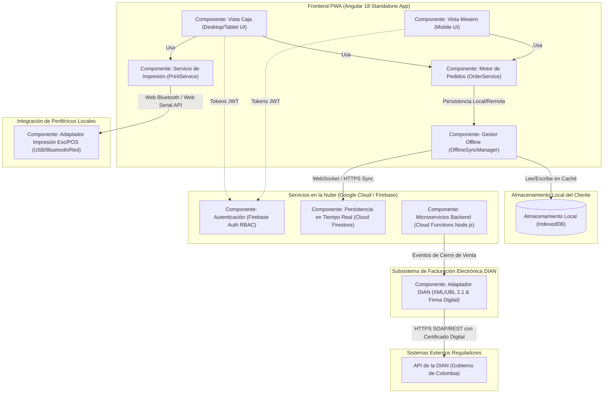
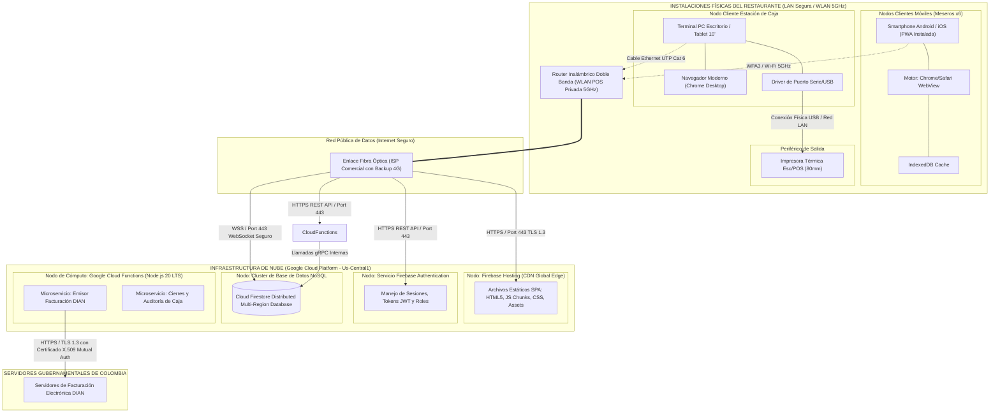

# EVIDENCIA GA4-220501095-AA2-EV06
# TALLER: ARQUITECTURA DE SOFTWARE

---

## PORTADA INSTITUCIONAL

<div align="center">

### **SERVICIO NACIONAL DE APRENDIZAJE — SENA**
**Centro de Teleinformática y Producción Industrial / Centro de Formación en Tecnologías**  
**Regional:** Distrito Capital / Cauca  
**Programa de Formación:** Tecnólogo en Análisis y Desarrollo de Software (ADSO)  
**Ficha de Caracterización:** 220501095  

---

### **INFORME TÉCNICO: TALLER DE ARQUITECTURA DE SOFTWARE**
**Código de la Evidencia:** GA4-220501095-AA2-EV06  
**Fase del Proyecto Formativo:** Planeación (Guía de Aprendizaje 4)  
**Competencia Asociada:** 220501095 — Diseñar la solución de software de acuerdo con los requerimientos y modelos de diseño  
**Actividad de Aprendizaje:** AA2 — Elaborar la arquitectura de software de acuerdo con el patrón de diseño y requerimientos del sistema  
**Instrumento de Evaluación:** IE-GA4-220501095-AA2-EV06  

---

**Autor / Aprendiz:**  
Johan Sebastián (Aprendiz ADSO)  

**Instructor Técnico Asignado:**  
Instructor de Área Técnica de Software  

**Proyecto de Referencia:**  
Sistema POS y Facturación Electrónica — Restaurante Señor Hornado  

**Fecha de Entrega:**  
Octubre de 2026  
**Versión del Documento:**  
1.0 — Versión Final  

</div>

---

## TABLA DE CONTENIDO

1. [Introducción](#1-introducción)
   - 1.1 [Contexto y Justificación en la Fase de Planeación](#11-contexto-y-justificación-en-la-fase-de-planeación)
   - 1.2 [Objetivo General](#12-objetivo-general)
   - 1.3 [Objetivos Específicos](#13-objetivos-específicos)
   - 1.4 [Sistema de Referencia Tecnológica](#14-sistema-de-referencia-tecnológica)
2. [Desarrollo del Taller: Preguntas Orientadoras](#2-desarrollo-del-taller-preguntas-orientadoras)
   - 2.1 [Pregunta 1: ¿Qué se entiende por Arquitectura de Software?](#21-pregunta-1-qué-se-entiende-por-arquitectura-de-software)
     - 2.1.1 [Definición Conceptual y Fundamentos Teóricos](#211-definición-conceptual-y-fundamentos-teóricos)
     - 2.1.2 [Estructura Global y Propiedades del Sistema](#212-estructura-global-y-propiedades-del-sistema)
     - 2.1.3 [Relación con el Ciclo de Vida del Desarrollo de Software (SDLC)](#213-relación-con-el-ciclo-de-vida-del-desarrollo-de-software-sdlc)
     - 2.1.4 [Cuadro Comparativo: Niveles de Abstracción en la Ingeniería de Software](#214-cuadro-comparativo-niveles-de-abstracción-en-la-ingeniería-de-software)
   - 2.2 [Pregunta 2: ¿Cuál es su Función en un Sistema de Software?](#22-pregunta-2-cuál-es-su-función-en-un-sistema-de-software)
     - 2.2.1 [Orquestación y Organización de Componentes](#221-orquestación-y-organización-de-componentes)
     - 2.2.2 [Garantía de Atributos de Calidad (Mantenibilidad, Escalabilidad, Disponibilidad y Rendimiento)](#222-garantía-de-atributos-de-calidad-mantenibilidad-escalabilidad-disponibilidad-y-rendimiento)
     - 2.2.3 [Mitigación Sistemática de Riesgos Técnicos y Deuda Técnica](#223-mitigación-sistemática-de-riesgos-técnicos-y-deuda-técnica)
     - 2.2.4 [Comunicación Efectiva entre Interesados (Stakeholders)](#224-comunicación-efectiva-entre-interesados-stakeholders)
   - 2.3 [Pregunta 3: ¿Cómo se Elabora la Arquitectura de Software?](#23-pregunta-3-cómo-se-elabora-la-arquitectura-de-software)
     - 2.3.1 [Metodología de Diseño: Enfoque ADD (Attribute-Driven Design)](#231-metodología-de-diseño-enfoque-add-attribute-driven-design)
     - 2.3.2 [Análisis y Clasificación de Requerimientos: Drivers Arquitectónicos](#232-análisis-y-clasificación-de-requerimientos-drivers-arquitectónicos)
     - 2.3.3 [Especificación de Escenarios de Atributos de Calidad](#233-especificación-de-escenarios-de-atributos-de-calidad)
     - 2.3.4 [Selección y Evaluación de Estilos y Patrones Arquitectónicos](#234-selección-y-evaluación-de-estilos-y-patrones-arquitectónicos)
     - 2.3.5 [Toma de Decisiones y Registro en ADR (Architectural Decision Records)](#235-toma-de-decisiones-y-registro-en-adr-architectural-decision-records)
   - 2.4 [Pregunta 4: ¿Cómo Lograr una Buena Arquitectura de Software?](#24-pregunta-4-cómo-lograr-una-buena-arquitectura-de-software)
     - 2.4.1 [Principios Fundamentales de Diseño Estructural](#241-principios-fundamentales-de-diseño-estructural)
     - 2.4.2 [Principios SOLID Aplicados al Nivel Arquitectónico](#242-principios-solid-aplicados-al-nivel-arquitectónico)
     - 2.4.3 [Principios Complementarios: DRY, KISS, YAGNI y Separación de Incumbencias (SoC)](#243-principios-complementarios-dry-kiss-yagni-y-separación-de-incumbencias-soc)
     - 2.4.4 [Incorporación de Patrones de Diseño (Cumplimiento Criterio 1 IE-GA4-220501095-AA2-EV06)](#244-incorporación-de-patrones-de-diseño-cumplimiento-criterio-1-ie-ga4-220501095-aa2-ev06)
   - 2.5 [Pregunta 5: ¿Cuáles son los Elementos de Diseño de una Arquitectura de Software?](#25-pregunta-5-cuáles-son-los-elementos-de-diseño-de-una-arquitectura-de-software)
     - 2.5.1 [Componentes, Interfaces, Módulos y Conectores](#251-componentes-interfaces-módulos-y-conectores)
     - 2.5.2 [El Marco de Vistas Arquitectónicas: Modelo 4+1 de Kruchten](#252-el-marco-de-vistas-arquitectónicas-modelo-41-de-kruchten)
     - 2.5.3 [Identificación y Fundamentación de la Vista de Componentes (Cumplimiento Criterio 2)](#253-identificación-y-fundamentación-de-la-vista-de-componentes-cumplimiento-criterio-2)
     - 2.5.4 [Identificación y Justificación de la Vista de Despliegue (Cumplimiento Criterio 3)](#254-identificación-y-justificación-de-la-vista-de-despliegue-cumplimiento-criterio-3)
     - 2.5.5 [Decisiones de Infraestructura y Topología Operativa](#255-decisiones-de-infraestructura-y-topología-operativa)
3. [Matriz de Evaluación Frente a la Lista de Chequeo IE-GA4-220501095-AA2-EV06](#3-matriz-de-evaluación-frente-a-la-lista-de-chequeo-ie-ga4-220501095-aa2-ev06)
4. [Conclusiones](#4-conclusiones)
5. [Referencias Bibliográficas](#5-referencias-bibliográficas)

---

## 1. INTRODUCCIÓN

### 1.1 Contexto y Justificación en la Fase de Planeación

En el marco del programa Tecnólogo en Análisis y Desarrollo de Software (ADSO) del Servicio Nacional de Aprendizaje (SENA), la **Guía de Aprendizaje 4 (GA4)** sitúa al aprendiz en la fase crucial de **Planeación**, orientada a la competencia **220501095: Diseñar la solución de software de acuerdo con los requerimientos y modelos de diseño**.

Tras haber culminado con éxito las etapas de levantamiento de requisitos, especificación formal mediante historias de usuario y casos de uso, modelos de dominio y estimación técnica y económica (fases precedentes de la formación), el proyecto se enfrenta al desafío de articular la solución informática a nivel estructural. Construir software sin una arquitectura formalmente concebida es el equivalente a edificar un rascacielos sin planos estructurales ni cálculos de cargas: el colapso operativo, la degradación de rendimiento y la imposibilidad de mantenimiento serán consecuencias inevitables.

El presente informe técnico desarrolla la evidencia **GA4-220501095-AA2-EV06: Taller. Arquitectura de software**, con el propósito de analizar, sustentar y responder de forma crítica y argumentada a las preguntas orientadoras sobre los principios, métodos, patrones y modelos de representación que gobiernan la disciplina de la arquitectura de software moderna.

### 1.2 Objetivo General

Elaborar un informe técnico argumentado que aborde en profundidad los conceptos fundamentales, metodológicos y prácticos de la arquitectura de sistemas de software, fundamentando la incorporación de patrones de diseño, la vista de componentes y la vista de despliegue según los lineamientos de la lista de chequeo **IE-GA4-220501095-AA2-EV06**.

### 1.3 Objetivos Específicos

1. Definir conceptualmente la arquitectura de software, su anatomía global y su influencia determinante a lo largo de cada fase del ciclo de vida del desarrollo de software (SDLC).
2. Analizar el propósito funcional de la arquitectura en la satisfacción de atributos de calidad (mantenibilidad, escalabilidad, disponibilidad y rendimiento) y en la reducción de riesgos de negocio y técnicos.
3. Describir la metodología sistemática para elaborar la arquitectura de software a partir del análisis de impulsores arquitectónicos (*Architectural Drivers*) y la especificación de escenarios de calidad.
4. Identificar las mejores prácticas, principios de ingeniería (alta cohesión, bajo acoplamiento, principios SOLID) e incorporar patrones de diseño reconocidos para asegurar la mantenibilidad del código fuente.
5. Modelar y fundamentar la **vista de componentes** y la **vista de despliegue**, proporcionando diagramas formales y justificaciones técnicas aplicadas a un entorno de implantación real.

### 1.4 Sistema de Referencia Tecnológica

Para brindar un sustento práctico y aplicado a los conceptos abstractos de este taller, los ejemplos, patrones, vistas y decisiones arquitectónicas se ilustran tomando como caso de estudio el proyecto formativo en ejecución: el **"Sistema POS y Facturación Electrónica para el Restaurante Señor Hornado"**.

* **Frontend:** Single Page Application (SPA) y Progressive Web App (PWA) construida en Angular 18 (Arquitectura basada en Componentes Autónomos *Standalone*, Reactividad por *Signals*, TypeScript 5.5, Mobile-First con Tailwind CSS).
* **Backend y Persistencia:** Arquitectura Serverless / Backend as a Service (BaaS) soportada en Google Cloud Platform y Firebase (Cloud Firestore con sincronización reactiva en tiempo real, Firebase Authentication, Cloud Functions para microservicios de backend).
* **Servicios de Integración:** Adaptador de facturación electrónica compatible con el modelo normativo DIAN (Colombia) y pasarela de impresión térmica Esc/POS (USB/Bluetooth/Red).

---

## 2. DESARROLLO DEL TALLER: PREGUNTAS ORIENTADORAS

### 2.1 Pregunta 1: ¿Qué se entiende por Arquitectura de Software?

#### 2.1.1 Definición Conceptual y Fundamentos Teóricos

La **arquitectura de software** representa la estructura de más alto nivel de un sistema informático. No se trata simplemente de código fuente, diagramas de clases aislados o tecnologías específicas elegidas para programar; constituye el conjunto de decisiones fundamentales sobre la organización del sistema, sus componentes estructurales y las relaciones que estos mantienen entre sí.

De acuerdo con la norma internacional **ISO/IEC/IEEE 42010:2011** (*Systems and software engineering — Architecture description*):
> *"La arquitectura son los conceptos o propiedades fundamentales de un sistema en su entorno, materializados en sus elementos, relaciones y en los principios de su diseño y evolución."*

De manera concordante, **Len Bass, Paul Clements y Rick Kazman**, investigadores eméritos del *Software Engineering Institute (SEI)* de la Universidad Carnegie Mellon, formulan en su obra cumbre *Software Architecture in Practice* la definición canónica más aceptada en la industria:
> *"La arquitectura de software de un programa o sistema computacional es la estructura o estructuras del sistema, que comprenden los elementos de software, las propiedades visibles externamente de esos elementos y las relaciones entre ellos."*

Esta definición encierra tres afirmaciones cardinales:
1. **El software posee múltiples estructuras:** Un sistema no puede comprenderse mediante un único diagrama. Posee una estructura de descomposición modular en tiempo de desarrollo, una estructura de procesos concurrentes en tiempo de ejecución y una estructura física de asignación a servidores y redes en tiempo de despliegue.
2. **Propiedades externamente visibles:** La arquitectura se enfoca en las interfaces públicas, los contratos de servicio, los protocolos y los compromisos de calidad (latencia, rendimiento, disponibilidad) que un componente expone a los demás, ocultando los detalles de implementación interna.
3. **Las decisiones tempranas de diseño:** La arquitectura representa aquellas decisiones de ingeniería que resultan extraordinariamente costosas, complejas o imposibles de modificar una vez que la construcción del sistema ha iniciado o alcanzado producción.

#### 2.1.2 Estructura Global y Propiedades del Sistema

La estructura global de la arquitectura define el esqueleto sobre el cual operará la lógica del negocio. Dicha estructura establece:
* **La partición o descomposición del dominio:** Cómo se segmenta un problema complejo en subsistemas independientes, capas o microservicios con responsabilidades acotadas.
* **Los canales y mecanismos de interacción:** La manera en que fluyen los datos y eventos entre componentes (llamadas síncronas RPC/HTTP REST, colas de mensajería asíncrona, flujos de eventos basados en el patrón Publicador/Suscriptor o sockets en tiempo real).
* **Los límites de frontera (*Boundaries*):** Las reglas estrictas de dependencia entre capas y módulos, garantizando que los módulos de infraestructura externa o interfaz de usuario no contaminen la lógica central del negocio.

#### 2.1.3 Relación con el Ciclo de Vida del Desarrollo de Software (SDLC)

La arquitectura de software no es un artefacto estático ni una fase aislada; interactúa directamente con cada etapa del ciclo de vida del software, ejerciendo un rol rector:

```
  +------------------+       +-------------------+       +--------------------+
  | 1. REQUERIMIENTOS| ----> | 2. ARQUITECTURA   | ----> | 3. DISEÑO DETALLADO|
  |  (Drivers & RNF) |       | (Estructura/Vistas|       |  (Clases/Estruct.) |
  +------------------+       +-------------------+       +--------------------+
                                      |
                                      v
  +------------------+       +-------------------+       +--------------------+
  | 6. MANTENIMIENTO | <---- |  5. DESPLIEGUE    | <---- | 4. IMPLEMENTACIÓN  |
  |  Y EVOLUCIÓN     |       | (DevOps & Infra)  |       |   Y PRUEBAS        |
  +------------------+       +-------------------+       +--------------------+
```

* **Fase de Análisis de Requerimientos:** La arquitectura filtra y traduce los requerimientos funcionales y los Atributos de Calidad (Requerimientos No Funcionales) en restricciones de diseño comprobables. Un requerimiento que exige *"emitir un ticket de comanda en menos de 2 segundos ante caída de internet"* se convierte directamente en una decisión arquitectónica: implementación de almacenamiento local (*Offline-First*) y sincronización bidireccional asíncrona.
* **Fase de Diseño Detallado:** Actúa como el marco de referencia y contenedor. Los diseñadores y programadores diseñan clases, esquemas relacionales o componentes de interfaz sabiendo de antemano qué interfaces deben implementar, qué patrones de fábrica utilizar y cómo comunicarse con el resto del ecosistema sin romper las capas.
* **Fase de Construcción (Codificación):** Establece los *guardarraíles* del código fuente. Define la estructura de carpetas, el empaquetado de librerías, las convenciones de nomenclatura, la inyección de dependencias y los mecanismos de manejo de errores globales.
* **Fase de Pruebas (Testing y QA):** Provee la base para las pruebas no funcionales: pruebas de carga y estrés (verificación de escalabilidad), pruebas de penetración (verificación de seguridad) y pruebas de integración entre contratos de interfaces.
* **Fase de Despliegue y Operación:** Dicta las condiciones de infraestructura: aprovisionamiento de servidores, topología de redes, políticas de balanceo de carga, monitoreo de salud (*health checks*) y planes de contingencia ante desastres.
* **Fase de Mantenimiento y Evolución:** Determina si el sistema puede recibir nuevas funcionalidades en el transcurso de los años con bajo costo marginal o si, por el contrario, cada modificación introducirá regresiones en partes no relacionadas del código (deuda técnica incontrolada).

#### 2.1.4 Cuadro Comparativo: Niveles de Abstracción en la Ingeniería de Software

Para clarificar los límites conceptuales, la siguiente tabla diferencia la arquitectura frente a los otros niveles de diseño e implementación:

| Dimensión | Requerimientos | Arquitectura de Software | Diseño Detallado | Implementación / Código |
| :--- | :--- | :--- | :--- | :--- |
| **Pregunta que responde** | *¿Qué debe resolver el sistema?* | *¿Cómo se estructura globalmente para garantizar calidad?* | *¿Cómo se estructuran los módulos internos?* | *¿Cómo se escribe la lógica exacta en sintaxis ejecutable?* |
| **Nivel de Abstracción** | Conceptual / Negocio | Alto nivel de abstracción | Nivel medio de abstracción | Nivel concreto / Operativo |
| **Artefactos Clave** | Historias de Usuario, Casos de Uso, SRS (IEEE 830) | Diagramas de Componentes, Vistas de Despliegue, ADRs | Diagramas de Clases, Diagramas de Secuencia, DDL BD | Archivos `.ts`, `.py`, `.sql`, componentes HTML/CSS |
| **Costo de Modificación** | Bajo a Medio (fase inicial) | **Extremadamente Alto** (crítico) | Medio | Bajo (localizado a funciones) |
| **Enfoque Principal** | Necesidades del usuario final | Atributos de calidad y restricciones | Algoritmos, estructuras de datos y métodos | Sintaxis, compilación, librerías y pruebas unitarias |

---

### 2.2 Pregunta 2: ¿Cuál es su Función en un Sistema de Software?

#### 2.2.1 Orquestación y Organización de Componentes

La función primordial de la arquitectura de software es dotar de **orden, cohesión y estructura lógica** a una masa potencialmente caótica de requisitos, algoritmos y tecnologías. En sistemas de mediana y gran envergadura, la ausencia de arquitectura conduce indefectiblemente al antipatrón denominado **"Big Ball of Mud"** (Gran Bola de Lodo): un sistema sin estructura discernible donde cualquier parte interactúa arbitrariamente con cualquier otra, haciendo imposible su depuración o actualización.

La arquitectura orquesta los componentes definiendo:
1. **La asignación unívoca de responsabilidades:** Cada módulo o subsistema atiende una preocupación de negocio delimitada (Bounded Context en términos de Domain-Driven Design).
2. **Las jerarquías y sentidos de dependencia:** Impone que las capas superiores utilicen abstracciones de las capas inferiores, prohibiendo dependencias circulares o saltos descontrolados entre módulos.
3. **El protocolo de comunicación inter-componentes:** Estandariza si la comunicación será reactiva mediante flujos de datos observables, mensajes REST síncronos o eventos desacoplados en buses de mensajería.

#### 2.2.2 Garantía de Atributos de Calidad

Los usuarios suelen juzgar el software por sus funciones visibles (crear una factura, listar productos). No obstante, los mayores fracasos de la ingeniería de software derivan del incumplimiento de sus **Atributos de Calidad (Requerimientos No Funcionales)**. La función de la arquitectura es diseñar proactivamente las estructuras que satisfagan dichos atributos:

* **Mantenibilidad:** Capacidad del software para ser modificado, corregido, adaptado o mejorado con el mínimo esfuerzo y sin generar efectos secundarios no deseados. Se logra mediante bajo acoplamiento, alta cohesión y segregación de interfaces.
* **Escalabilidad:** Capacidad del sistema para manejar un incremento en la carga de trabajo (usuarios concurrentes, transacciones de venta, volumen de datos) sin degradar su tiempo de respuesta. La arquitectura decide si la escalabilidad será *vertical* (incrementando CPU/RAM) u *horizontal* (incorporando más nodos mediante microservicios independientes y balanceadores de carga).
* **Disponibilidad y Tolerancia a Fallos:** Proporción de tiempo en que el sistema se encuentra operativo y accesible. La arquitectura incorpora mecanismos de redundancia, almacenamiento en caché, disyuntores de circuito (*Circuit Breakers*) y modos de degradación elegante (por ejemplo, permitir la toma de pedidos fuera de línea si el enlace central falla).
* **Rendimiento y Eficiencia:** Tiempos de respuesta y consumo de recursos. Se garantiza arquitectónicamente mediante el uso de índices optimizados, procesamiento asíncrono en segundo plano y modelos reactivos de propagación de cambios (evitando peticiones de sondeo continuo *polling*).
* **Seguridad:** Protección contra accesos no autorizados, corrupción o fugas de información sensible. La arquitectura define el modelo de autenticación federada (OAuth 2.0, JWT), control de acceso basado en roles (RBAC) y cifrado tanto en tránsito (TLS 1.3) como en reposo.

#### 2.2.3 Mitigación Sistemática de Riesgos Técnicos y Deuda Técnica

En cualquier proyecto de software existe un conjunto de incertidumbres: ¿Soportará la base de datos picos transaccionales?, ¿qué ocurre si el proveedor de facturación electrónica cambia su API?, ¿cómo afectará la latencia de red en zonas comerciales congestionadas?

La función de la arquitectura es actuar como un **amortiguador y mitigador de riesgos**:
* **Aislamiento de la volatilidad tecnológica:** Mediante la inserción de interfaces y capas adaptadoras (patrón Puertos y Adaptadores o Arquitectura Hexagonal), los cambios en librerías de terceros, bases de datos o pasarelas tributarias no impactan el núcleo de las reglas del negocio.
* **Prevención de la Deuda Técnica:** Al establecer contratos claros, estándares de codificación y verificaciones arquitectónicas automatizadas en los pipelines de integración continua (CI), se evita la degradación progresiva de la base de código.
* **Viabilidad de Prototipos de Arquitectura (*Spikes*):** Permite validar experimentalmente hipótesis críticas sobre rendimiento o sincronización en fases tempranas, evitando descubrimientos catastróficos al final del proyecto.

#### 2.2.4 Comunicación Efectiva entre Interesados (Stakeholders)

Un sistema de software involucra a múltiples actores con visiones, intereses y jergas profesionales radicalmente distintas:

```
                          +------------------------+
                          |   CLIENTE / NEGOCIO    |
                          | (ROI, Costos, Plazos)  |
                          +------------------------+
                                      ^
                                      |
  +----------------------+            v            +-----------------------+
  |  DESARROLLADORES     | <---> ARQUITECTURA <--> |     OPERACIONES /     |
  | (Código, Librerías,  |       DE SOFTWARE       |  INFRAESTRUCTURA      |
  |  Patrones, APIs)     |                         | (Cloud, Redes, SLAs)  |
  +----------------------+            ^            +-----------------------+
                                      |
                                      v
                          +------------------------+
                          |    TESTERS / QA        |
                          | (Escenarios de Calidad,|
                          |  Pruebas de Carga/Seg) |
                          +------------------------+
```

La arquitectura de software funge como el **lenguaje común y vehículo de negociación** que unifica estas perspectivas. Permite explicar al cliente por qué se requiere una inversión en almacenamiento en la nube para garantizar disponibilidad del 99.9%, a la vez que indica al equipo de desarrollo qué contratos de software deben respetar de manera innegociable.

---

### 2.3 Pregunta 3: ¿Cómo se Elabora la Arquitectura de Software?

#### 2.3.1 Metodología de Diseño: Enfoque ADD (Attribute-Driven Design)

La elaboración de una arquitectura no es un acto de inspiración espontánea, sino un **proceso de ingeniería sistemático, disciplinado e iterativo**. La metodología más sólida y reconocida internacionalmente es el método **ADD (Attribute-Driven Design)** desarrollado por el *Software Engineering Institute (SEI)*.

El método ADD concibe el diseño arquitectónico como un proceso guiado primordialmente por la satisfacción de los atributos de calidad (los *drivers* arquitectónicos). El flujo metodológico se estructura en los siguientes pasos:

```
  +-------------------------------------------------------------------------------+
  | 1. RECOPILAR Y PRIORIZAR DRIVERS ARQUITECTÓNICOS (RF, RNF/QAs y Restricciones)|
  +-------------------------------------------------------------------------------+
                                          |
                                          v
  +-------------------------------------------------------------------------------+
  | 2. ELEGIR UN ELEMENTO DEL SISTEMA A DESCOMPONER/DISEÑAR                       |
  +-------------------------------------------------------------------------------+
                                          |
                                          v
  +-------------------------------------------------------------------------------+
  | 3. IDENTIFICAR Y SELECCIONAR CONCEPTOS DE DISEÑO (Estilos, Tácticas, Patrones)|
  +-------------------------------------------------------------------------------+
                                          |
                                          v
  +-------------------------------------------------------------------------------+
  | 4. INSTANCIAR ELEMENTOS ARQUITECTÓNICOS Y ASIGNAR RESPONSABILIDADES           |
  +-------------------------------------------------------------------------------+
                                          |
                                          v
  +-------------------------------------------------------------------------------+
  | 5. DEFINIR INTERFACES Y CONECTORES ENTRE LOS ELEMENTOS                        |
  +-------------------------------------------------------------------------------+
                                          |
                                          v
  +-------------------------------------------------------------------------------+
  | 6. EVALUAR Y VERIFICAR EL DISEÑO FRENTE A LOS ESCENARIOS DE CALIDAD           |
  +-------------------------------------------------------------------------------+
                                          |
                                          v
                         ¿Quedan drivers por satisfacer?
                           /                         \
                     [SÍ] /                           \ [NO]
                         v                             v
                  Siguiente Iteración             FIN: Documentar Vistas
                                                  y Decisiones (ADRs)
```

#### 2.3.2 Análisis y Clasificación de Requerimientos: Drivers Arquitectónicos

No todos los requerimientos impactan la arquitectura. Los requerimientos que moldean estructuralmente el sistema se denominan **Impulsores Arquitectónicos (*Architectural Drivers*)** y se clasifican en tres categorías:

1. **Requerimientos Funcionales de Alto Impacto:** Funcionalidades críticas del negocio cuya ejecución demanda interacción compleja de subsistemas (ej. procesamiento transaccional de pagos concurrentes, emisión y firma XML de facturación DIAN).
2. **Requerimientos No Funcionales / Atributos de Calidad (QAs):** Restricciones cuantitativas de rendimiento, disponibilidad, seguridad, mantenibilidad y portabilidad.
3. **Restricciones de Negocio y Tecnológicas (*Constraints*):** Condiciones ineludibles impuestas por el entorno, tales como presupuesto limitado, hardware preexistente (impresoras térmicas USB/Bluetooth), normativas legales (resoluciones DIAN en Colombia) o el stack de lenguajes dominado por el equipo.

#### 2.3.3 Especificación de Escenarios de Atributos de Calidad

Para evitar descripciones ambiguas como *"el sistema debe ser rápido y seguro"*, la ingeniería de software prescribe el uso de **Escenarios de Calidad Formales**, compuestos por 6 partes:

```
[Fuente del Estímulo] -> [Estímulo] -> [Artefacto Afectado] -> [Entorno] -> [Respuesta] -> [Medida de Respuesta]
```

A continuación se ejemplifican dos escenarios arquitectónicos clave formulados para el sistema POS del Restaurante Señor Hornado:

| Componente del Escenario | Escenario 1: Disponibilidad y Modo Offline | Escenario 2: Rendimiento y Concurrencia |
| :--- | :--- | :--- |
| **Fuente del Estímulo** | Red de telecomunicaciones del local. | 6 meseros ingresando pedidos de mesas simultáneamente. |
| **Estímulo** | Caída total del enlace de internet (falla del ISP). | Registro masivo de pedidos en hora pico de almuerzo. |
| **Artefacto** | Subsistema POS móvil (PWA en terminal del mesero). | Backend de base de datos reactiva (Cloud Firestore). |
| **Entorno** | Operación normal en salón de atención al comensal. | Operación a máxima concurrencia del establecimiento. |
| **Respuesta** | La aplicación detecta el estado offline y almacena las comandas en el almacenamiento local del dispositivo (IndexedDB). | El sistema procesa los pedidos concurrentes y notifica a caja en tiempo real mediante listeners de eventos. |
| **Medida de Respuesta** | Cero interrupción en la toma de pedidos; sincronización automática total en menos de 5 segundos tras restablecerse la conexión a internet. | Tiempo de latencia percibido en la terminal de mesero inferior a 300 ms; actualización de la pantalla de caja en menos de 800 ms. |

#### 2.3.4 Selección y Evaluación de Estilos y Patrones Arquitectónicos

Con los drivers formalizados, el arquitecto selecciona el o los **Estilos Arquitectónicos** que gobernarán el sistema. Un estilo arquitectónico provee una familia de sistemas en términos de patrones de organización estructural.

A continuación se presenta un análisis comparativo de los principales estilos arquitectónicos evaluados en la industria:

```
  +----------------------------------------------------------------------------------------------------+
  |                                   ESTILOS ARQUITECTÓNICOS PRINCIPALES                              |
  +----------------------------------------------------------------------------------------------------+
  | 1. ARQUITECTURA EN CAPAS (N-Tier):                                                                 |
  |    Organización jerárquica estricta: Presentación -> Lógica de Negocio -> Acceso a Datos.          |
  |    + Alta simplicidad y facilidad de prueba.                                                       |
  |    - Acoplamiento en cascada; puede volverse monolítica y difícil de escalar independientemente.   |
  +----------------------------------------------------------------------------------------------------+
  | 2. ARQUITECTURA HEXAGONAL / PUERTOS Y ADAPTADORES (Clean Architecture):                            |
  |    El núcleo del negocio (dominio) es el centro, totalmente aislado de frameworks y bases de datos.|
  |    + Mantenibilidad y testeabilidad insuperables; desacoplamiento radical de tecnologías externas. |
  |    - Mayor número de interfaces, conversiones de entidades (DTOs) y curva de aprendizaje inicial.  |
  +----------------------------------------------------------------------------------------------------+
  | 3. ARQUITECTURA BASADA EN MICROSERVICIOS:                                                          |
  |    Conjunto de pequeños servicios autónomos, cada uno ejecutando su propio proceso y base de datos.|
  |    + Escalabilidad horizontal independiente; aislamiento total de fallos por servicio.             |
  |    - Altísima complejidad operativa (consistencia distribuida, monitoreo de red, latencia de red).|
  +----------------------------------------------------------------------------------------------------+
  | 4. ARQUITECTURA SERVERLESS / BACKEND AS A SERVICE (BaaS):                                          |
  |    La lógica de datos y autenticación reside en servicios gestionados; la lógica puntual en FaaS.  |
  |    + Mantenimiento de infraestructura casi nulo; escalabilidad elástica y costos por consumo real.|
  |    - Vendor lock-in con el proveedor de nube; menor control sobre la infraestructura subyacente.   |
  +----------------------------------------------------------------------------------------------------+
```

*Decisión para el Caso Señor Hornado:* Se adoptó un **enfoque híbrido compuesto por una Arquitectura Hexagonal a nivel de diseño de componentes cliente y backend, soportada sobre una infraestructura Serverless / BaaS (Firebase + Cloud Functions)**. Esta combinación asegura que la lógica de cálculo de impuestos, cierres de caja y facturación no dependa de Firebase, permitiendo una portabilidad inmediata hacia PostgreSQL u otro motor en el futuro, aprovechando simultáneamente la reactividad en tiempo real y el costo operacional cero durante períodos sin concurrencia.

#### 2.3.5 Toma de Decisiones y Registro en ADR (Architectural Decision Records)

Una arquitectura bien elaborada debe quedar documentada de forma transparente para las generaciones presentes y futuras de desarrolladores. Para ello, se utiliza el estándar de la industria **ADR (Architectural Decision Record)**. Un ADR captura el contexto, la decisión técnica tomada, las alternativas descartadas y las consecuencias positivas y negativas resultantes.

Ejemplo sintético de un ADR formal para el sistema:

> **ADR-003: Adopción del Paradigma Reactivo basado en Signals sobre Observables RxJS para el Estado del POS**  
> * **Estado:** Aceptado.  
> * **Contexto:** El módulo de pedidos requiere una interfaz fluida, con respuestas inmediatas a la selección de platos en pantallas móviles táctiles. La sincronización de estado de la orden debe ser ultra liviana y predecible.  
> * **Decisión:** Utilizar Angular Signals de forma nativa para la gestión del estado reactivo del carrito de pedidos y la comanda, reservando RxJS únicamente para los flujos asíncronos de eventos provenientes de Firestore.  
> * **Consecuencias Positivas:** Rendimiento superior en la detección de cambios (Fine-Grained Reactivity), código más limpio sin necesidad de desuscribirse manualmente de observables en los componentes.  
> * **Consecuencias Negativas:** Requiere capacitación del equipo en las APIs de reactividad introducidas en Angular 18+.

---

### 2.4 Pregunta 4: ¿Cómo Lograr una Buena Arquitectura de Software?

#### 2.4.1 Principios Fundamentales de Diseño Estructural

Una "buena" arquitectura no se mide por la cantidad de tecnologías de moda empleadas, sino por su capacidad para **soportar el cambio, minimizar el costo de mantenimiento y garantizar la confiabilidad**. Para lograrlo, los ingenieros de software se basan en dos pilares indiscutibles:

1. **Bajo Acoplamiento (*Loose Coupling*):** El grado de interdependencia entre módulos de software debe reducirse al mínimo necesario. Dos módulos están débilmente acoplados si interactúan únicamente a través de contratos e interfaces abstractas, sin conocer los detalles de implementación interna del otro. De este modo, modificar la estructura de almacenamiento no desata errores en la vista de usuario.
2. **Alta Cohesión (*High Cohesion*):** Los elementos contenidos dentro de un módulo, clase o componente deben estar íntimamente relacionados entre sí y colaborar para cumplir un propósito único y bien delimitado. Un módulo que mezcla cálculo de cuentas, conexión a base de datos y renderizado HTML adolece de baja cohesión; un módulo dedicado exclusivamente a la emisión de documentos tributarios exhibe alta cohesión.

```
       [BAJA COHESIÓN Y ALTO ACOPLAMIENTO]               [ALTA COHESIÓN Y BAJO ACOPLAMIENTO]
                 (Mala Arquitectura)                             (Buena Arquitectura)

            +-----------------------+                    +-----------------+   +-----------------+
            |     MÓDULO MONOLITO   |                    | MÓDULO PEDIDOS  |   | MÓDULO FACTURAS |
            | - Lee base de datos   |                    | (Reglas orden)  |   | (Reglas DIAN)   |
            | - Calcula totales     |                    +-----------------+   +-----------------+
            | - Pinta HTML/CSS      |                             \                     /
            | - Imprime tickets     |                   (Usa contrato) \           / (Usa contrato)
            | - Valida impuestos    |                                   v         v
            +-----------------------+                         +-----------------------------+
                        |                                     |    INTERFAZ DE PERSISTENCIA |
                        v                                     +-----------------------------+
             Cualquier cambio rompe todo                                     |
                                                                             v
                                                              +-----------------------------+
                                                              |  ADAPTADOR FIRESTORE / SQL  |
                                                              +-----------------------------+
```

#### 2.4.2 Principios SOLID Aplicados al Nivel Arquitectónico

Propuestos por Robert C. Martin ("Uncle Bob"), los principios **SOLID** suelen enseñarse para la programación orientada a objetos, pero su mayor potencia se desata cuando se aplican a nivel de componentes y subsistemas arquitectónicos:

* **S — Single Responsibility Principle (Principio de Responsabilidad Única):** Un componente arquitectónico debe tener una, y solo una, razón para cambiar. En el POS, el componente encargado de procesar la lógica del carrito de compras jamás debe ser modificado por una variación en el formato de impresión del ticket.
* **O — Open/Closed Principle (Principio de Abierto/Cerrado):** Los subsistemas deben estar abiertos a la extensión pero cerrados a la modificación. El sistema debe permitir incorporar un nuevo método de pago (ej. Criptomonedas o Billeteras Digitales como Nequi/Daviplata) agregando una nueva clase que implemente la interfaz `PaymentMethod`, sin necesidad de alterar el código existente del motor de cobros.
* **L — Liskov Substitution Principle (Principio de Sustitución de Liskov):** Los módulos que implementen una interfaz abstracta deben ser capaces de sustituirse mutuamente sin alterar el comportamiento correcto del sistema. Una implementación `LocalMockDatabaseService` debe ser intercambiable con `FirestoreDatabaseService` durante las pruebas automatizadas sin generar fallos.
* **I — Interface Segregation Principle (Principio de Segregación de Interfaces):** Ningún cliente debe verse forzado a depender de métodos o interfaces que no utiliza. En lugar de una interfaz masiva `RestaurantManagementService`, se deben segregar contratos específicos: `IOrderPlacementService` (para meseros), `IBillingService` (para cajeros) y `IReportGenerationService` (para administradores).
* **D — Dependency Inversion Principle (Principio de Inversión de Dependencias):** Los módulos de alto nivel (políticas de negocio) no deben depender de los módulos de bajo nivel (detalles de frameworks, drivers de base de datos o hardware de impresión). Ambos deben depender de abstracciones. Esto preserva la independencia del negocio frente a decisiones tecnológicas temporales.

#### 2.4.3 Principios Complementarios: DRY, KISS, YAGNI y Separación de Incumbencias (SoC)

* **Separation of Concerns (SoC):** Descomponer la solución en áreas funcionales independientes, separando la interfaz de usuario, la validación de negocio y el acceso a infraestructura física.
* **DRY (Don't Repeat Yourself):** Cada porción de conocimiento o regla del negocio debe tener una representación única e inequívoca en el sistema. El cálculo del impuesto al consumo del 8% debe residir en un único servicio tributario centralizado, reutilizado por la vista previa del mesero, el cierre del cajero y la factura formal.
* **KISS (Keep It Simple, Stupid):** Evitar sobreingeniería. Elegir la arquitectura más sencilla que resuelva cabalmente los drivers de calidad. No implementar microservicios distribuidos con orquestadores Kubernetes para una aplicación que operará con 6 meseros y 1 cajero cuando una arquitectura Serverless modular satisface los requerimientos a una fracción del costo y esfuerzo.
* **YAGNI (You Aren't Gonna Need It):** No incorporar patrones ni componentes para requisitos especulativos futuros no solicitados.

#### 2.4.4 Incorporación de Patrones de Diseño (Cumplimiento Criterio 1 IE-GA4-220501095-AA2-EV06)

Para satisfacer el **Criterio 1 de la lista de chequeo**, la arquitectura debe incorporar formalmente **patrones de diseño**, orientados a las mejores prácticas de codificación, legibilidad y mantenibilidad del software. Los patrones de diseño representan soluciones probadas y reutilizables a problemas recurrentes en el diseño orientado a objetos y componentes.

Se estructuran en tres familias según la taxonomía canónica del *Gang of Four (GoF)*:

##### A. Patrones Creacionales (Creational Patterns)
* **Factory Method / Abstract Factory:** Provee una interfaz para crear familias de objetos relacionados o dependientes sin especificar sus clases concretas.
  * *Aplicación en la Arquitectura:* Creación dinámica de documentos tributarios. Dependiendo del tipo de cliente o monto, una factoría `InvoiceDocumentFactory` genera una instancia de `ElectronicInvoiceDIAN` o una `SimpleReceiptTicket`, encapsulando la lógica de inicialización y validación de esquemas XML complejos.
* **Singleton:** Garantiza que una clase posea una única instancia y provea un punto de acceso global a ella.
  * *Aplicación en la Arquitectura:* Gestión del canal físico de impresión térmica y el bus de eventos locales. En Angular, los servicios provistos en la raíz (`@Injectable({ providedIn: 'root' })`) operan arquitectónicamente bajo este patrón, garantizando que el `OfflineSyncEngine` mantenga un único punto de verdad para los datos locales.

##### B. Patrones Estructurales (Structural Patterns)
* **Adapter (Adaptador):** Convierte la interfaz de una clase o servicio externo en otra interfaz que el cliente espera, permitiendo el trabajo conjunto de componentes incompatibles.
  * *Aplicación en la Arquitectura:* Integración con la impresora térmica Esc/POS y la API del Proveedor Tecnológico DIAN. El subsistema de ventas interactúa contra la interfaz abstracta `IPrinterDevice`. Se crean adaptadores concretos: `EscPosBluetoothAdapter`, `EscPosUsbAdapter` y `NetworkPrinterAdapter`. De esta forma, cambiar la marca o el protocolo de la impresora no altera una sola línea de la lógica de ventas.
* **Facade (Fachada):** Proporciona una interfaz unificada y simplificada para un conjunto complejo de interfaces en un subsistema.
  * *Aplicación en la Arquitectura:* `CheckoutFacadeService`. El acto de cerrar una mesa involucra calcular propinas, aplicar descuentos, actualizar el estado de la mesa en Firestore, invocar la pasarela de pago, generar la factura electrónica y enviar la comanda a la impresora. En lugar de que el componente de interfaz gráfica coordine estas 6 llamadas, interactúa exclusivamente con la fachada `CheckoutFacade.completeOrder(orderId, paymentData)`.
* **Decorator (Decorador):** Añade responsabilidades adicionales a un objeto de forma dinámica sin modificar su estructura.
  * *Aplicación en la Arquitectura:* Implementación de interceptores HTTP y logging de auditoría para peticiones salientes hacia la DIAN, agregando cabeceras criptográficas y marcas temporales de seguridad sobre los mensajes.

##### C. Patrones Comportamentales (Behavioral Patterns)
* **Observer (Observador):** Define una dependencia de uno a muchos entre objetos, de modo que cuando un objeto cambia de estado, todos sus dependientes son notificados y actualizados automáticamente.
  * *Aplicación en la Arquitectura:* Piedra angular del sistema POS reactivo. Cuando el mesero registra un pedido en la mesa 4, el observable/listener de Cloud Firestore detecta la mutación en la base de datos distribuida y notifica inmediatamente a la pantalla del cajero (vista de tablet/escritorio), actualizando el mapa de mesas sin necesidad de refrescar la página.
* **Strategy (Estrategia):** Define una familia de algoritmos, encapsula cada uno y los hace intercambiables, permitiendo que el algoritmo varíe independientemente de los clientes que lo utilizan.
  * *Aplicación en la Arquitectura:* Cálculo de descuentos y procesamiento de medios de pago. La clase `PaymentProcessor` recibe en tiempo de ejecución una estrategia: `CashPaymentStrategy`, `CreditCardPaymentStrategy` o `ElectronicTransferStrategy`, cada una ejecutando sus propias validaciones y comisiones asociadas.
* **Repository (Repositorio):** Media entre la capa de dominio y la capa de mapeo de datos usando una interfaz tipo colección para acceder a los objetos del dominio.
  * *Aplicación en la Arquitectura:* `OrderRepository` y `ProductRepository`. La lógica de la aplicación consulta `orderRepository.getActiveOrders()`, desconociendo si la información proviene de la memoria caché, de una base IndexedDB local o de la nube de Firebase Firestore.

##### D. Matriz Resumen de Patrones de Diseño Incorporados

| Patrón de Diseño | Clasificación | Propósito Arquitectónico en el Sistema | Impacto Directo en Mantenibilidad y Calidad |
| :--- | :--- | :--- | :--- |
| **Strategy** | Comportamental | Intercambiar medios de pago (Efectivo, Tarjeta, Transferencia) y motores de liquidación de impuestos. | **Alta:** Permite agregar nuevos métodos de pago sin modificar las clases de cobro centrales. |
| **Adapter** | Estructural | Homogeneizar la comunicación con periféricos de hardware (Impresoras térmicas Esc/POS por USB, Bluetooth o Red). | **Alta:** Aísla el software de las particularidades y drivers de cada fabricante de hardware. |
| **Facade** | Estructural | Unificar el proceso transaccional de cierre de venta y emisión de factura ante múltiples subsistemas. | **Muy Alta:** Reduce drásticamente la complejidad ciclomática de las vistas de usuario. |
| **Observer** | Comportamental | Propagar cambios en tiempo real desde la base de datos hacia las pantallas de mesas y caja. | **Excelente:** Elimina el sobrecosto de peticiones de sondeo (*polling*) y desacopla emisor de receptores. |
| **Repository** | Estructural / Datos | Abstraer el origen de datos (Nube Firestore vs. Almacenamiento Local Offline IndexedDB). | **Crítica:** Garantiza la capacidad *Offline-First* sin duplicar la lógica de negocio. |
| **Factory Method** | Creacional | Instanciar documentos fiscales conforme a la regulación de la DIAN o tickets internos. | **Alta:** Centraliza la validación de esquemas XML tributarios y la firma digital. |

---

### 2.5 Pregunta 5: ¿Cuáles son los Elementos de Diseño de una Arquitectura de Software?

#### 2.5.1 Componentes, Interfaces, Módulos y Conectores

Una arquitectura de software se materializa a través de un conjunto preciso de bloques constructivos:

1. **Componentes:** Unidades computacionales o de almacenamiento ejecutables, autónomas y reutilizables, que encapsulan su estado y comportamiento interno. Un componente expone sus servicios exclusivamente a través de interfaces definidas (ej. Módulo de Facturación DIAN, Motor de Pedidos).
2. **Interfaces (Contratos):** Los puntos de acceso formales a través de los cuales un componente ofrece sus funcionalidades (*interfaz provista*) o requiere servicios externos para funcionar (*interfaz requerida*). Las interfaces garantizan que la implementación subyacente pueda reescribirse íntegramente siempre que el contrato público se mantenga intacto.
3. **Conectores:** Los mecanismos arquitectónicos que median la comunicación, coordinación y transferencia de datos entre componentes. Son conectores: las llamadas a procedimientos remotos (gRPC), las APIs REST sobre HTTP/HTTPS, los sockets TCP de sincronización bidireccional, las colas de mensajes y los buses de eventos.
4. **Módulos:** Agrupaciones lógicas de código fuente organizadas en tiempo de desarrollo (paquetes, librerías, carpetas funcionales) que facilitan la división del trabajo entre ingenieros de software.

#### 2.5.2 El Marco de Vistas Arquitectónicas: Modelo 4+1 de Kruchten

Ningún diagrama individual puede capturar la totalidad de un sistema complejo. Para resolver este desafío, **Philippe Kruchten** propuso en 1995 el **Modelo 4+1 Vistas**, formalizado posteriormente en el estándar **IEEE 42010**:

```
                       +-----------------------------------+
                       |        VISTA LÓGICA               |
                       | (Clases, Objetos, Dominio,        |
                       |  Estructura Funcional)            |
                       +-----------------------------------+
                                         |
                                         v
  +--------------------+       +-------------------+       +---------------------+
  | VISTA DE DESARROLLO|       |  VISTA DE CASOS   |       | VISTA DE PROCESOS   |
  |  (COMPONENTES)     | <---> |    DE USO (4+1)   | <---> | (Hilos, Concurrencia|
  | (Librerías, Módulos|       | (Escenarios Guía) |       |  Rendimiento)       |
  |  Estructura Código)|       +-------------------+       +---------------------+
  +--------------------+                 |
                                         v
                       +-----------------------------------+
                       |       VISTA DE DESPLIEGUE         |
                       | (Hardware, Servidores, Redes,     |
                       |  Nodos Físicos/Nube)              |
                       +-----------------------------------+
```

1. **Vista Lógica:** Describe las clases, servicios y paquetes que satisfacen los requerimientos funcionales del sistema.
2. **Vista de Procesos:** Aborda aspectos dinámicos de concurrencia, sincronización, hilos de ejecución y rendimiento.
3. **Vista de Desarrollo (Componentes):** Organiza los módulos de software, artefactos empaquetados y dependencias en tiempo de construcción.
4. **Vista Física (Despliegue):** Mapea los artefactos de software sobre los nodos de hardware, servidores y redes de telecomunicaciones.
5. **Vista de Escenarios (Casos de Uso):** Une las 4 vistas mediante historias de usuario clave que validan que el sistema responde de manera coherente.

A continuación, y en estricto cumplimiento de los **Criterios de Evaluación 2 y 3 de la lista de chequeo**, se identifican, fundamentan y modelan en detalle la **Vista de Componentes** y la **Vista de Despliegue**.

---

#### 2.5.3 Identificación y Fundamentación de la Vista de Componentes (Cumplimiento Criterio 2)

##### A. Fundamentación Técnica en Fases Avanzadas del Ciclo de Vida
La **Vista de Componentes** ilustra la organización estructural y las relaciones de dependencia entre los módulos de software en las fases avanzadas del ciclo de vida (desarrollo maduro, pruebas de integración, empaquetado y distribución). 

Su valor radica en:
* **Representar las unidades ejecutables y su encapsulamiento:** Permite verificar que los subsistemas no violen los principios de bajo acoplamiento y que interactúen a través de contratos explícitos.
* **Planificación del trabajo en paralelo:** Equipos de desarrollo independientes pueden construir la capa de autenticación, la interfaz móvil de meseros y el adaptador DIAN simultáneamente, regidos únicamente por las interfaces pactadas.
* **Trazabilidad frente a auditorías y mantenimiento:** Si la normativa fiscal cambia, la vista de componentes identifica de inmediato qué componentes están afectados (`DianBillingModule` y sus adaptadores), aislando el resto del sistema de cualquier riesgo colateral.

##### B. Modelado de la Vista de Componentes (Diagrama UML)
El siguiente diagrama UML de componentes modela la arquitectura modular del sistema POS Señor Hornado, detallando componentes internos, interfaces provistas (círculo) e interfaces requeridas (semicírculo):



##### C. Descripción de Componentes e Interfaces del Sistema

1. **`UI_OrderView` / `UI_CashierView` (Módulos de Presentación):** Componentes autónomos de interfaz gráfica con diseño adaptable. No poseen lógica de negocio directa; invocan servicios mediante inyección de dependencias.
2. **`OrderService` (Motor de Lógica de Negocio):** Gestiona la creación de órdenes, aplicación de recetas, cálculo de impuestos al consumo (8%) y validación de estados de comanda.
3. **`OfflineSyncManager` (Gestor de Sincronización y Persistencia):** Implementa el patrón Repositorio Híbrido. Detecta la presencia de conectividad: si hay red, sincroniza contra Cloud Firestore; si la red falla, enruta las transacciones hacia `IndexedDB` y activa un trabajador en segundo plano (*Background Sync*) que reintenta la subida al reanudarse el enlace.
4. **`PrintService` & `EscPosDriver`:** Subsistema de abstracción de hardware que transforma las órdenes en comandos binarios Esc/POS para el cortador y cabezal térmico de la impresora de tickets.
5. **`DianAdapter`:** Componente de backend aislado que recibe el cierre de cuenta, construye la estructura UBL 2.1 estándar, aplica el algoritmo de firma digital con el certificado electrónico del restaurante, genera el código CUFE (Código Único de Factura Electrónica), genera el código QR reglamentario y envía el documento hacia los servidores de la DIAN.

---

#### 2.5.4 Identificación y Justificación de la Vista de Despliegue (Cumplimiento Criterio 3)

##### A. Justificación Técnica para las Condiciones de Implantación
La **Vista de Despliegue** dictamina cómo los componentes de software lógicos se asignan y distribuyen físicamente sobre la infraestructura de hardware, dispositivos de usuario, topologías de red y servidores en la nube.

La justificación técnica de esta vista para el proyecto radica en:
* **Garantía de la operación ininterrumpida del restaurante:** El entorno físico de un restaurante presenta retos severos: zonas muertas de señal Wi-Fi por paredes de ladrillo y campanas de cocina, interferencias electromagnéticas por motores de refrigeración y caídas frecuentes del servicio de internet comercial. La vista de despliegue demuestra cómo la arquitectura garantiza el servicio mediante una red de área local robusta y redundancia local.
* **Aislamiento de redes y seguridad perimetral:** Los dispositivos móviles de los meseros operan en una red WLAN privada y aislada de la red Wi-Fi de clientes invitados, protegiendo las órdenes de ataques de denegación de servicio o intercepción de paquetes.
* **Costo operacional y escalabilidad elástica en la nube:** La infraestructura en la nube está completamente distribuida en centros de datos con certificación ISO 27001 y SOC 2 (Google Cloud), eliminando la necesidad de mantener un servidor físico local encendido en el restaurante (el cual estaría expuesto a cortes de energía, polvo de cocina o daños en el disco duro).

##### B. Modelado de la Vista de Despliegue (Diagrama UML)
El siguiente diagrama UML de despliegue detalla la topología física, los nodos de cómputo, protocolos de comunicación y enlaces de red necesarios para la implantación del sistema:



##### C. Especificaciones de Implantación y Topología de Red

1. **Segmento de Salón y Caja (Red Local):**
   * **Nodos Móviles (Meseros):** Dispositivos móviles con pantalla táctil de al menos 5.5", navegadores con soporte de Service Workers y almacenamiento Web Storage API. Consumen la aplicación PWA directamente desde la memoria caché del navegador tras la primera descarga.
   * **Nodo de Caja:** Equipo de cómputo con conexión cableada vía Ethernet para máxima estabilidad, conectado directamente a la impresora térmica de 80 mm mediante cable USB de alta velocidad o red LAN interna.
   * **Topología Inalámbrica:** Red Wi-Fi en frecuencia de 5 GHz con cifrado WPA2/WPA3 Enterprise para evitar interferencias por hornos microondas u otros electrodomésticos de la cocina que operan en 2.4 GHz.
2. **Segmento de Nube (Backend Serverless):**
   * **CDN Edge Hosting:** Los assets del frontend se distribuyen a través de una red global de entrega de contenidos (CDN) con compresión Brotli y almacenamiento en caché perimetral, reduciendo el tiempo de carga inicial a menos de 1 segundo.
   * **Base de Datos Multi-Región:** Cloud Firestore garantiza una disponibilidad del 99.999% con replicación automática entre centros de datos.
   * **Cómputo Aislado en Cloud Functions:** Los microservicios de facturación operan en contenedores efímeros que escalan automáticamente desde 0 hasta cientos de instancias concurrentes según la demanda de facturas generadas.
3. **Seguridad y Enlaces:**
   * Todas las comunicaciones externas utilizan **TLS 1.3** cifrado sobre el puerto estándar 443.
   * Las reglas de seguridad de Firestore (*Security Rules*) validan en cada operación que el usuario que intenta escribir una comanda posea el rol verificado de `mesero` o `cajero` en su token criptográfico JWT emitido por Firebase Auth.

---

### 2.5.5 Decisiones de Infraestructura y Topología Operativa

Para completar los elementos de diseño, la siguiente matriz sintetiza las decisiones de infraestructura adoptadas, contrastadas con sus alternativas y justificación técnica:

| Elemento de Infraestructura | Opción Seleccionada | Alternativa Evaluada | Justificación de Ingeniería |
| :--- | :--- | :--- | :--- |
| **Alojamiento de la Solución** | Nube Serverless (Firebase / Google Cloud) | Servidor Físico Local (On-Premise en Restaurante) | El servidor local exige mantenimiento continuo, aire acondicionado, UPS y copias de seguridad manuales; la nube provee alta disponibilidad y cero mantenimiento físico a un costo menor. |
| **Estrategia de Datos Offline** | IndexedDB + Service Workers (PWA) | Exigencia de Conectividad Permanente | El restaurante no puede detener sus ventas si se corta internet. La persistencia local desacopla la operación física de la conectividad WAN. |
| **Pipeline de Despliegue** | CI/CD Automatizado (GitHub Actions) | Despliegue Manual por FTP / SSH | Elimina el error humano; ejecuta linters, validaciones de tipos TypeScript y pruebas unitarias antes de publicar cambios a producción. |
| **Protocolo de Base de Datos** | WebSockets con Firestore Listeners | Peticiones HTTP Polling Periódicas | El *polling* genera miles de peticiones innecesarias saturando el router del local; los sockets mantienen un canal abierto ultraligero que solo transmite datos cuando ocurre una mutación real. |

---

## 3. MATRIZ DE EVALUACIÓN FRENTE A LA LISTA DE CHEQUEO IE-GA4-220501095-AA2-EV06

Para garantizar la obtención de la calificación cualitativa de **A (Aprobado)**, se verifica de forma explícita el cumplimiento de cada uno de los criterios exigidos en el instrumento de evaluación institucional del SENA:

| No. | Criterio de Evaluación Institucional (IE-GA4-220501095-AA2-EV06) | Estado | Evidencia y Sección en este Informe Técnico |
| :---: | :--- | :---: | :--- |
| **1** | **Incorporar patrones de diseño propendiendo en las mejores prácticas para la codificación y mantenibilidad del software.** | **CUMPLIDO** | Desarrollado exhaustivamente en la **Sección 2.4 (2.4.1 a 2.4.4)**. Se analizaron y ejemplificaron patrones creacionales (Factory, Singleton), estructurales (Adapter, Facade, Decorator, Repository) y comportamentales (Observer, Strategy), sustentando su aporte al desacoplamiento, principios SOLID y mantenibilidad del código en el proyecto POS. |
| **2** | **Identificar y fundamentar la vista de componentes para representar el software en fases avanzadas del ciclo de vida.** | **CUMPLIDO** | Desarrollado exhaustivamente en la **Sección 2.5.3**. Se sustentó el valor de la vista de componentes en fases avanzadas de codificación y pruebas, complementado con un **Diagrama UML de Componentes** detallado que especifica componentes, interfaces provistas y requeridas, dependencias y encapsulamiento. |
| **3** | **Identificar y justificar la vista de despliegue para determinar las condiciones de implantación de la solución informática.** | **CUMPLIDO** | Desarrollado exhaustivamente en la **Sección 2.5.4**. Se justificaron técnicamente las condiciones reales de implantación (contingencia offline, topología de red Wi-Fi 5 GHz, periféricos térmicos Esc/POS, microservicios serverless en la nube) y se modeló el **Diagrama UML de Despliegue** con nodos, artefactos, puertos y protocolos. |

---

## 4. CONCLUSIONES

1. **La arquitectura de software es el cimiento estratégico indispensable de cualquier solución computacional:** Lejos de ser un ejercicio puramente teórico, la arquitectura define la estructura, los límites de responsabilidad y las directrices que permiten a un sistema resistir el paso del tiempo, adaptarse a requerimientos emergentes y mantenerse inmune a la degradación por deuda técnica.
2. **Los Atributos de Calidad gobiernan el diseño estructural:** Las funcionalidades de un sistema carecen de valor si la aplicación es inestable, lenta, vulnerable o imposible de modificar. Metodologías como el diseño guiado por atributos (ADD) y la formulación de escenarios de calidad garantizan que la arquitectura resuelva de forma prioritaria los desafíos no funcionales más críticos del negocio.
3. **Los patrones de diseño son catalizadores de la calidad del código:** La incorporación intencional de patrones como *Strategy*, *Adapter*, *Observer* y *Repository* permite transformar principios abstractos como el bajo acoplamiento y la alta cohesión en estructuras de clases e interfaces limpias, facilitando la mantenibilidad, la testeabilidad y la escalabilidad del software en fases avanzadas del ciclo de vida.
4. **La dualidad entre la Vista de Componentes y la Vista de Despliegue es vital para el éxito del proyecto:** Mientras que la vista de componentes ordena la construcción del software en tiempo de desarrollo y pruebas, la vista de despliegue garantiza su viabilidad en el mundo físico y operativo. En el caso del sistema POS para el Restaurante Señor Hornado, ambas vistas demuestran cómo la combinación de una PWA reactiva con capacidades *Offline-First* y un backend en la nube Serverless resuelve de manera óptima las necesidades operativas de la empresa con costos mínimos de infraestructura.

---

## 5. REFERENCIAS BIBLIOGRÁFICAS

* **Bass, L., Clements, P., & Kazman, R.** (2012). *Software Architecture in Practice* (3rd ed.). Addison-Wesley Professional.
* **Fowler, M.** (2002). *Patterns of Enterprise Application Architecture*. Addison-Wesley Professional.
* **Gamma, E., Helm, R., Johnson, R., & Vlissides, J.** (1994). *Design Patterns: Elements of Reusable Object-Oriented Software*. Addison-Wesley.
* **IEEE Computer Society.** (2011). *ISO/IEC/IEEE 42010:2011 - Systems and software engineering — Architecture description*. IEEE Standards Association.
* **Kruchten, P.** (1995). *Architectural Blueprints—The “4+1” View Model of Software Architecture*. IEEE Software, 12(6), 42-50.
* **Martin, R. C.** (2017). *Clean Architecture: A Craftsman's Guide to Software Structure and Design*. Prentice Hall.
* **Pressman, R. S., & Maxim, B. R.** (2020). *Software Engineering: A Practitioner's Approach* (9th ed.). McGraw-Hill Education.
* **Servicio Nacional de Aprendizaje — SENA.** (2024). *Guía de Aprendizaje 4: Fase de Planeación - Diseño de Soluciones de Software (Código 220501095)*. Dirección de Formación Profesional.
* **Sommerville, I.** (2011). *Software Engineering* (9th ed.). Addison-Wesley.
